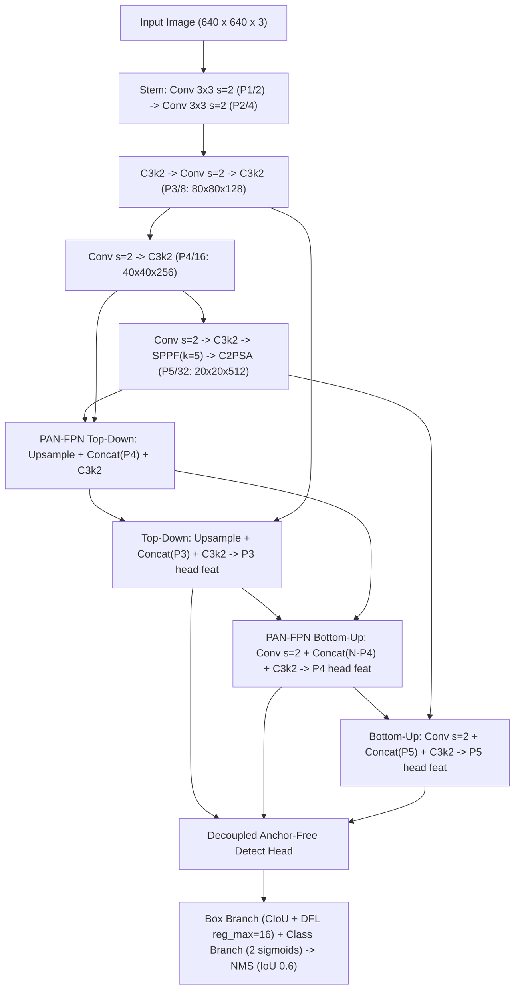
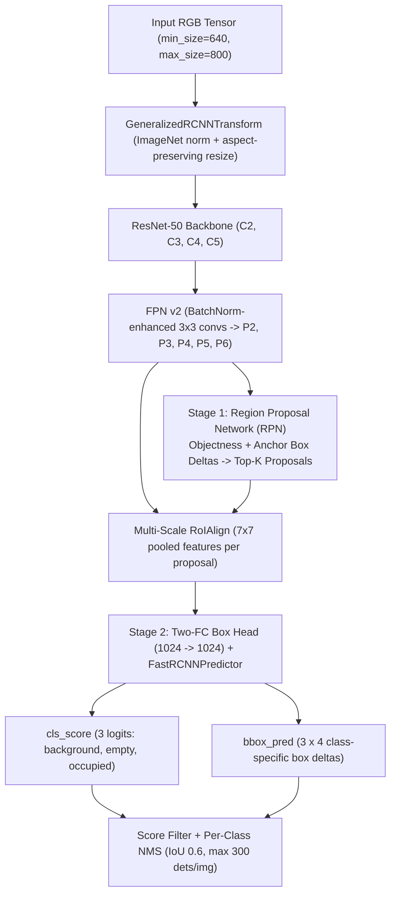
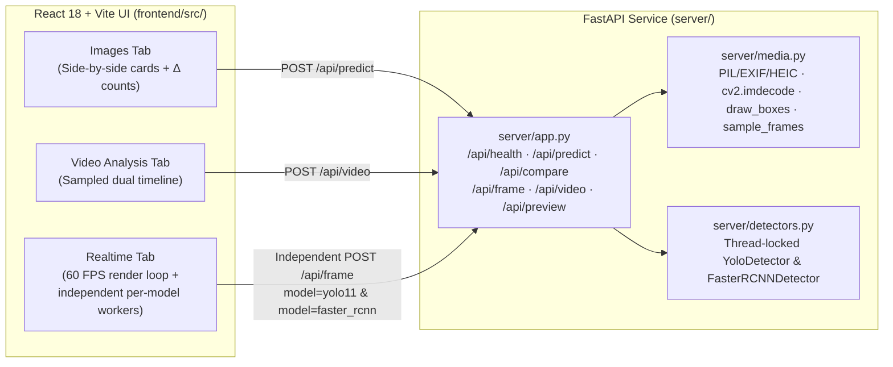

# Model & System Architecture — YOLOv11s vs. Faster R-CNN

**Project:** Parking Lot Occupancy Detection (`empty` vs. `occupied`)  
**Status:** Both models trained, benchmarked on identical YOLO bounding-box annotations, and deployed side by side in FastAPI, React, and Docker.

---

## Table of Contents

1. [Executive Comparison](#1-executive-comparison)
2. [Shared Dataset & Annotation Pipeline](#2-shared-dataset--annotation-pipeline)
3. [Model 1 — YOLOv11-small (One-Stage, Anchor-Free)](#3-model-1--yolov11-small-one-stage-anchor-free)
4. [Model 2 — Faster R-CNN ResNet50-FPN-v2 (Two-Stage, Region-Proposal)](#4-model-2--faster-r-cnn-resnet50-fpn-v2-two-stage-region-proposal)
5. [Training Configurations & Convergence](#5-training-configurations--convergence)
6. [Held-Out Evaluation & Error Analysis](#6-held-out-evaluation--error-analysis)
7. [Inference Service & Real-Time Streaming Architecture](#7-inference-service--real-time-streaming-architecture)
8. [Design Trade-offs & Known Limitations](#8-design-trade-offs--known-limitations)

---

## 1. Executive Comparison

This project intentionally pairs two contrasting object detection paradigms on the **exact same dataset and bounding-box labels** so accuracy, error modes, memory footprint, and real-time throughput can be compared apples-to-apples:

| Dimension | YOLOv11s (`configs/yolo11_parking.yaml`) | Faster R-CNN (`configs/faster_rcnn.yaml`) |
|---|---|---|
| **Paradigm** | One-stage, anchor-free | Two-stage, anchor-based RPN + RoIAlign |
| **Backbone** | CSP-style Conv + `C3k2` + `SPPF` + `C2PSA` | `ResNet-50` + `FPN v2` (improved conv blocks) |
| **Neck** | PAN-FPN (top-down + bottom-up) | 5-level FPN (`P2`–`P6`) |
| **Detection Head** | Decoupled `Detect` on `P3/8`, `P4/16`, `P5/32` | RPN → RoIAlign → 2-FC `FastRCNNPredictor` |
| **Class Outputs** | `2` (`0: empty`, `1: occupied`) | `3` (`0: __background__`, `1: empty`, `2: occupied`) |
| **Parameters** | **9,428,566** (9,413,574 fused) | 43,261,278 (43,035,934 trainable) |
| **Checkpoint Size** | **18.3 MB** | 165.4 MB |
| **Input Scale** | 640 × 640 letterbox | `min_size=640`, `max_size=800` aspect-preserving |
| **Precision / AMP** | Fused Conv+BN, FP16 on CUDA | `torch.amp.autocast("cuda")` FP16 on CUDA |
| **Test mAP50** | **0.9691** | 0.9619 (−0.0072) |
| **Test mAP50-95** | **0.7048** | 0.6770 (−0.0277) |
| **Test Precision** | 0.9109 | **0.9465** (+0.0355) |
| **Test Recall** | **0.9500** | 0.9268 (−0.0231) |
| **Cross-Class Swaps (@ 0.25)** | **0** | **0** |
| **Batch=1 GPU Latency (RTX 3050)** | **17.23 ms/img** | 71.68 ms/img (4.16× slower) |
| **Realtime `/api/frame` Throughput** | **44.4 FPS** | 12.6 FPS |

---

## 2. Shared Dataset & Annotation Pipeline

Both detectors train and evaluate directly against `parking-space.v1i.yolov11/data.yaml` — **zero dataset duplication or offline format conversion**.

| Split | Images | Bounding Boxes | `empty` (0) | `occupied` (1) |
|---|---:|---:|---:|---:|
| Train | 496 | 3,780 | 2,422 | 1,358 |
| Valid | 62 | 429 | 284 | 145 |
| Test | 62 | 514 | 372 | 142 |
| **Total** | **620** | **4,723** | **3,078** | **1,645** |

### Shared Annotation Adapter (`src/data.py`)

YOLO stores one `.txt` file per image with normalized center-format rows:

```text
<class_id> <cx> <cy> <width> <height>    # all coordinates in [0, 1]
```

`src/data.py` (`parse_yolo_label_file` & `YoloParkingDataset`) translates each label file on the fly for Faster R-CNN:

1. **EXIF orientation normalization** (`ImageOps.exif_transpose`) so width/height match visual pixel coordinates.
2. **Coordinate conversion & clamping:**
   $$x_1 = \text{clip}((c_x - w/2) \cdot W,\, 0,\, W), \quad y_1 = \text{clip}((c_y - h/2) \cdot H,\, 0,\, H)$$
   $$x_2 = \text{clip}((c_x + w/2) \cdot W,\, 0,\, W), \quad y_2 = \text{clip}((c_y + h/2) \cdot H,\, 0,\, H)$$
   Degenerate boxes (`width < 1 px` or `height < 1 px`) are dropped; empty label files return zero-length tensors cleanly.
3. **Class ID shift:** Torchvision Faster R-CNN reserves label `0` for `__background__`. `YoloParkingDataset` shifts YOLO class IDs by `+1` (`0 → 1`, `1 → 2`) during training, and `src/metrics.py` + `server/detectors.py` shift predictions by `-1` (`1 → 0: empty`, `2 → 1: occupied`) during evaluation and inference.
4. **Identical evaluation math (`src/metrics.py`):** Both models are scored with greedy 1-to-1 IoU matching over `0.50:0.95` (10 thresholds) and Ultralytics's `ap_per_class` so PR curves, mAP50, mAP50-95, and confusion matrices are strictly comparable.

---

## 3. Model 1 — YOLOv11-small (One-Stage, Anchor-Free)

Defined in [`configs/yolo11_parking.yaml`](../configs/yolo11_parking.yaml) (`nc: 2`, scale `s: [0.50, 0.50, 1024]`) and inspected via `src/yolo/inspect_model.py`.



### Key Architectural Facts (`src/yolo/inspect_model.py`)
- **Stages:** 24 modules (11 backbone, 11 PAN-FPN neck, 1 decoupled `Detect` head)
- **Feature pyramid strides:** `P3/8` `(1, 128, 80, 80)`, `P4/16` `(1, 256, 40, 40)`, `P5/32` `(1, 512, 20, 20)`
- **Attention & pooling:** `SPPF(5)` captures multi-scale spatial context; `C2PSA` applies partial spatial attention on deep `P5` features to disambiguate occluded/adjacent stalls.
- **Computational cost:** 9,428,566 parameters (9,413,574 after Conv+BN fusion), **21.4 GFLOPs** @ 640 px.
- **Weight transfer:** 493 / 499 parameter tensors transfer directly from COCO-pretrained `yolo11s.pt`; only the 6 classification-head tensors are re-initialized for `nc=2`.

---

## 4. Model 2 — Faster R-CNN ResNet50-FPN-v2 (Two-Stage, Region-Proposal)

Defined in [`src/faster_rcnn/model.py`](../src/faster_rcnn/model.py) and configured via [`configs/faster_rcnn.yaml`](../configs/faster_rcnn.yaml). Supports four swappable torchvision backbones (`resnet50_fpn_v2`, `resnet50_fpn`, `mobilenet_v3_large_fpn`, `mobilenet_v3_large_320_fpn`), defaulting to **`resnet50_fpn_v2`**.



### Key Architectural Facts
- **Two-stage refinement:** Stage 1 (RPN) proposes candidate parking-space regions across 5 FPN levels (`P2`–`P6`); Stage 2 (`RoIAlign` + `FastRCNNPredictor`) pools fixed `7×7` features per proposal and jointly classifies (`__background__`, `empty`, `occupied`) and refines each bounding box.
- **Why `resnet50_fpn_v2`:** Uses the improved torchvision v2 architecture (BatchNorm in FPN & RPN heads, stronger COCO pretraining) for higher localization precision than classic `resnet50_fpn`.
- **Dense-lot configuration:** `box_detections_per_img` is raised from torchvision's default `100` to **`300`** so wide overhead parking lots never truncate detections; `box_nms_thresh = 0.6` matches YOLOv11.
- **Parameters:** 43,261,278 total (43,035,934 trainable; stem conv + early stage frozen per torchvision standard).
- **4 GB VRAM engineering:** Trains comfortably at ~1.54 GB peak VRAM on an RTX 3050 Laptop GPU using `batch=2` × `grad_accum=4` (effective batch size `8`, matching YOLOv11) + `torch.amp.autocast("cuda")` FP16 + gradient clipping (`max_norm=10.0`).

---

## 5. Training Configurations & Convergence

Both models deliberately use **geometry-preserving augmentations** — horizontal flips and mild color/HSV jitter are enabled, while rotation, shear, perspective warp, and vertical flips are disabled so parking-stall geometry stays realistic.

| Setting | YOLOv11s (`configs/train_hyp.yaml`) | Faster R-CNN (`configs/faster_rcnn.yaml`) |
|---|---|---|
| **Optimizer** | AdamW (`wd=0.0005`, `momentum=0.937`) | AdamW (`wd=0.0005`, `grad_clip=10.0`) |
| **Learning Rate** | `1e-3` → `1e-5` cosine (3 warmup epochs) | `1.5e-4` → `5e-6` cosine (2 warmup epochs) |
| **Effective Batch** | `8` (micro-batch 8) | `8` (micro-batch 2 × grad accum 4) |
| **Epochs Run** | 100 (~15.7 min on RTX 3050) | 20 (~28.2 min on RTX 3050) |
| **Losses** | Box CIoU (7.5) + Cls BCE (0.5) + DFL (1.5) | RPN Obj + RPN Box + RoI Cls + RoI Box |
| **Augmentations** | FlipLR 0.5, HSV, translate, scale, mosaic, erasing | FlipLR 0.5, ColorJitter (B/C 0.25, S 0.4, H 0.015) |
| **Best Val mAP50-95** | **0.7514** (epoch 97) | 0.7331 (epoch 17) |
| **Peak Val mAP50** | 0.9755 (epoch 78) | **0.9798** (epoch 9) |

### Faster R-CNN Training Trajectory (`runs/faster_rcnn/parking_frcnn/results.csv`)

| Epoch | Train Loss | Val Precision | Val Recall | Val mAP50 | Val mAP50-95 |
|---:|---:|---:|---:|---:|---:|
| 1 | 0.8152 | 0.7784 | 0.9091 | 0.8979 | 0.5728 |
| 3 | 0.3986 | 0.8762 | 0.9493 | 0.9616 | 0.6692 |
| 6 | 0.2961 | 0.8980 | 0.9441 | 0.9656 | 0.6956 |
| 9 | 0.2379 | 0.9101 | **0.9697** | **0.9798** | 0.7137 |
| 13 | 0.1658 | 0.9219 | 0.9533 | 0.9765 | 0.7205 |
| **17 (best)** | 0.1089 | 0.9361 | 0.9519 | 0.9764 | **0.7331** |
| 20 | 0.0927 | 0.9282 | 0.9521 | 0.9687 | 0.7275 |

---

## 6. Held-Out Evaluation & Error Analysis

Benchmarked on the held-out **test split** (62 images, 514 ground-truth boxes) at `conf=0.001` (standard mAP) and `iou=0.6` via `src/compare.py --split test`:

### Per-Class Test Metrics

| Class (Instances) | Model | Precision | Recall | mAP50 | mAP50-95 |
|---|---|---:|---:|---:|---:|
| `empty` (372) | **YOLOv11s** | 0.9163 | **0.9543** | **0.9843** | **0.6968** |
| `empty` (372) | **Faster R-CNN** | **0.9506** | 0.9382 | 0.9776 | 0.6649 |
| `occupied` (142) | **YOLOv11s** | 0.9056 | **0.9456** | **0.9538** | **0.7127** |
| `occupied` (142) | **Faster R-CNN** | **0.9423** | 0.9155 | 0.9463 | 0.6891 |

### Error Profile at Operating Threshold (`conf = 0.25`)

- **YOLOv11s:** `0` empty↔occupied swaps, `18` false alarms, `66` missed spaces — slightly conservative (prefers missing a distant/occluded stall over emitting a false alarm).
- **Faster R-CNN:** `0` empty↔occupied swaps, `49` false alarms (`35 empty`, `14 occupied`), only `13` missed spaces (`6 empty`, `7 occupied`) — recovers more marginal/distant spaces at `conf=0.25`, with higher overall max-F1 precision (`0.9465`) when tuned to its optimal confidence threshold.

---

## 7. Inference Service & Real-Time Streaming Architecture



### Real-Time Pipeline Engineering
- **Decoupled 60 FPS rendering (`frontend/src/hooks/useLiveDetection.js`):** `requestAnimationFrame` continuously renders the live `<video>` element onto the display canvas(es) at native frame rate and overlays the latest detections — eliminating box flicker and frame stuttering.
- **Independent per-model workers:** In side-by-side live mode, `yolo11` and `faster_rcnn` run independent back-to-back async loops capturing 640 px JPEG frames (`quality=0.65`) and scaling boxes cleanly onto the 960 px display canvas. YOLOv11 runs at **~44 FPS** without ever waiting on Faster R-CNN (**~12.6 FPS**).
- **Zero-PIL fast path (`server/media.py` + `server/detectors.py`):** `/api/frame` decodes bytes directly with `cv2.imdecode`, passes NumPy arrays straight into `predict_frame_bgr()` under per-detector `threading.Lock`s via `asyncio.to_thread`, and returns only JSON boxes + counts + GPU latency.
- **Graceful single-model fallback:** If Faster R-CNN's 166 MB checkpoint is not present (e.g., fresh GitHub clone), the server starts cleanly with YOLOv11, reports `faster_rcnn.available = false` in `/api/health`, and automatically lazy-loads Faster R-CNN as soon as weights are trained.

---

## 8. Design Trade-offs & Known Limitations

- **When to choose YOLOv11s:** Default choice for production, live CCTV/webcam streams, and edge GPUs — **4.2× faster**, **4.6× fewer parameters**, **9× smaller checkpoint** (18 MB vs. 166 MB), and slightly higher overall `mAP50-95` (`0.7048` vs. `0.6770`).
- **When to choose Faster R-CNN:** Valuable as a two-stage reference baseline and for high-precision offline image analysis (`0.9465` precision) or side-by-side verification on ambiguous scenes.
- **Dataset split leakage:** The Roboflow v1 export was split by frame rather than by source video (17 of 37 training videos also appear in `valid` and 18 in `test`). Both models share this exact split so their *relative* comparison is fair, but absolute mAP values are optimistic for unseen camera angles — re-split by video ID for strict generalization benchmarking.
- **Class imbalance:** Training contains ~1.8× more `empty` boxes (2,422) than `occupied` boxes (1,358); monitor `occupied` recall when expanding the dataset.
- **Docker GPU note:** Docker Desktop on Linux executes containers in a lightweight VM (CPU inference). Use native Docker Engine + NVIDIA Container Toolkit with `docker-compose.gpu.yml` for containerized CUDA acceleration.
